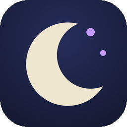
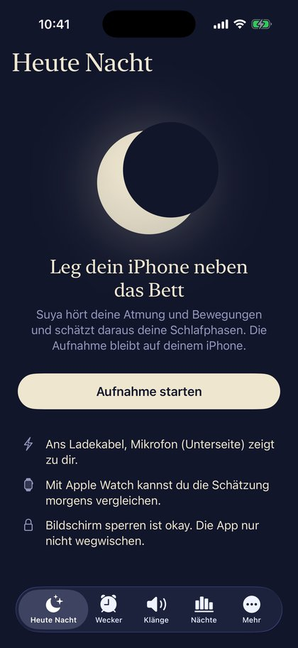
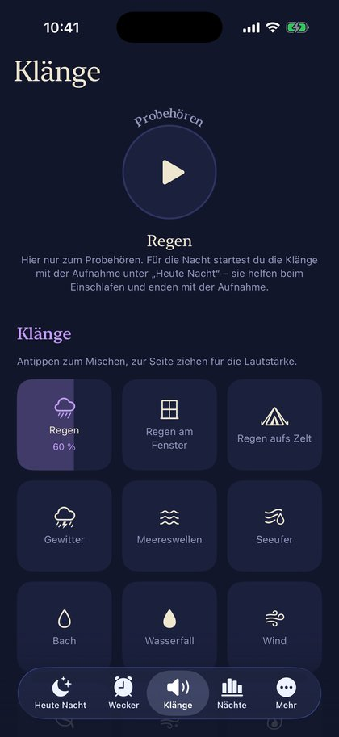
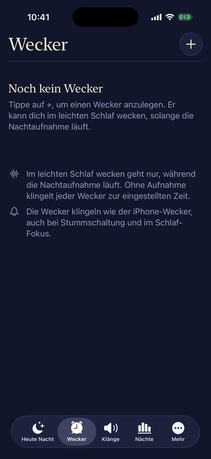
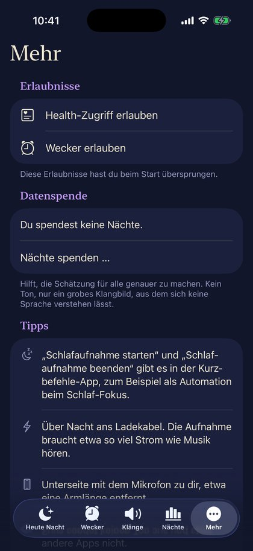

<p align="center">
  
</p>

<h1 align="center">Suya</h1>
<p align="center"><b>Schlaf-Tracker fürs iPhone, der einfach zuhört.</b><br>
Leg das iPhone neben das Bett – Suya erkennt aus Atmung und Bewegung deine Schlafphasen.<br>
Ohne Uhr, ohne Armband, ohne Cloud.</p>

## Was Suya kann

<table>
<tr>
<td width="230"></td>
<td>
<h3>Einfach hinlegen</h3>
iPhone ans Ladekabel, neben das Bett, Aufnahme starten. Suya hört nur zu – ohne Uhr, ohne Armband.
Live-Aktivität auf dem Sperrbildschirm, Kurzbefehle („Schlafaufnahme starten“) für den Schlaf-Fokus
und eine ruhige Ansicht im Querformat für den Nachttisch.
</td>
</tr>
<tr>
<td>
<h3>Schlafphasen auf dem iPhone</h3>
Ein kleines neuronales Netz erkennt aus Atmung und Bewegung <b>Wach, REM, Kern- und Tiefschlaf</b> –
direkt auf dem Gerät, nichts geht in eine Cloud. Dazu ein Schlafwert aus Dauer, Ruhe, Tief- und
REM-Schlaf und Aufwachen. Auf Wunsch landen die Phasen in <b>Apple Health</b>; mit Apple Watch siehst
du beide Schätzungen nebeneinander.
</td>
<td width="230"></td>
</tr>
<tr>
<td></td>
<td>
<h3>Alle Nächte im Blick</h3>
Jede Nacht mit Schlafwert und Mini-Zeitstrahl. Gedrückt halten zum Löschen, Exportieren oder Spenden;
der Ton bleibt 24 Stunden zum Export verfügbar.
</td>
</tr>
<tr>
<td>
<h3>27 Einschlafklänge</h3>
Regen am Fenster, Lagerfeuer, Meereswellen, Schneesturm, Klangschalen und mehr – echte Aufnahmen,
frei mischbar, mit Timer und sanftem Ausblenden, sobald du eingeschlafen bist. Laufende Klänge zählen
nicht in die Auswertung.
</td>
<td></td>
</tr>
<tr>
<td></td>
<td>
<h3>Wecken im leichten Schlaf</h3>
Wecker nach Uhrzeit oder Schlafdauer. Während die Aufnahme läuft, weckt Suya im gewählten Zeitraum,
sobald du leicht schläfst – und klingelt wie der iPhone-Wecker, auch bei Stummschaltung und im
Schlaf-Fokus.
</td>
</tr>
<tr>
<td>
<h3>Datenschutz zuerst</h3>
Ausgewertet wird auf dem iPhone. Nach 24 Stunden wird der Ton gelöscht; übrig bleibt nur ein grobes
Klangbild, aus dem sich keine Sprache verstehen lässt.<br><br>
<b>Freiwillige Datenspende:</b> Wer möchte, spendet einzelne Nächte (Klangbild und Schlafphasen, keine
Aufnahmen) an einen eigenen Server in Hamburg, damit das Modell besser wird – Widerruf und Löschung
jederzeit in der App.<br><br>
<a href="https://suya.ng-lab.de/datenschutz">Datenschutzerklärung</a> ·
<a href="https://suya.ng-lab.de/impressum">Impressum</a><br><br>
In 10 Sprachen: Deutsch, Englisch, Spanisch, Französisch, Italienisch, Portugiesisch, Niederländisch,
Japanisch, Koreanisch, Chinesisch.
</td>
<td></td>
</tr>
</table>

## Installieren (SideStore)

SideStore → **Sources** → **+** → diese Adresse eintragen:

```
https://github.com/NikGro/suya/releases/latest/download/source.json
```

Danach Suya einmal aus dieser Quelle installieren. Neue Versionen erscheinen dann automatisch unter
„My Apps“. Damit Suya mit einer kostenlosen Apple-ID auf Apple Health zugreifen darf, braucht es ein
leicht angepasstes SideStore – siehe [sidestore/README.md](sidestore/README.md).

Versionen heißen *Jahr.Monat.Nummer* (z. B. `26.11.14`); jeder Push auf `main` baut und veröffentlicht
eine neue Version.

## Aufbau

| Ordner | Inhalt |
|---|---|
| `SleepSonar/` | die App (SwiftUI): Aufnahme, Auswertung, Wecker, Klänge, Datenspende |
| `Packages/SonarDSP/` | Signalverarbeitung (Log-Mel-Spektrogramm, Normierung) mit Tests |
| `Widgets/` | Live-Aktivität und Widgets |
| `training/` | Training des Schlafphasen-Modells (PyTorch → Core ML) |
| `server/` | Server für Datenspende, Fehlerberichte und die Webseiten (läuft auf einer Synology) |
| `scripts/` | Übersetzungen, Klänge, Hilfsskripte |

**Das Modell** lernt aus Tonaufnahmen von Schlaflabor-Messungen (öffentlicher Datensatz) und aus eigenen
Nächten mit Apple-Watch-Schlafphasen. Aufbau angelehnt an SoundSleepNet: Log-Mel-Spektrogramm je
30-Sekunden-Abschnitt → kleines CNN → bidirektionales GRU über die ganze Nacht.

## Lizenz

[PolyForm Noncommercial 1.0.0](LICENSE): Ansehen, Ausprobieren, Verändern und Weitergeben sind für
nicht-kommerzielle Zwecke erlaubt; kommerzielle Nutzung nur mit schriftlicher Erlaubnis.
Die Schlafklänge stammen von freesound.org (CC0 / CC BY) und stehen unter ihren eigenen Lizenzen –
Namensnennung in der App unter „Quellen der Klänge“.

---

<sub>**English:** Suya is an iPhone sleep tracker that only listens: put the phone next to your bed and an
on-device neural network estimates your sleep stages (wake, REM, core, deep) from breathing and movement
sounds – no watch, no cloud. It writes to Apple Health, has a smart alarm that wakes you in light sleep,
27 high-quality sleep sounds and is available in 10 languages. Install via SideStore with the source URL
above. Source-available under the PolyForm Noncommercial License.</sub>
