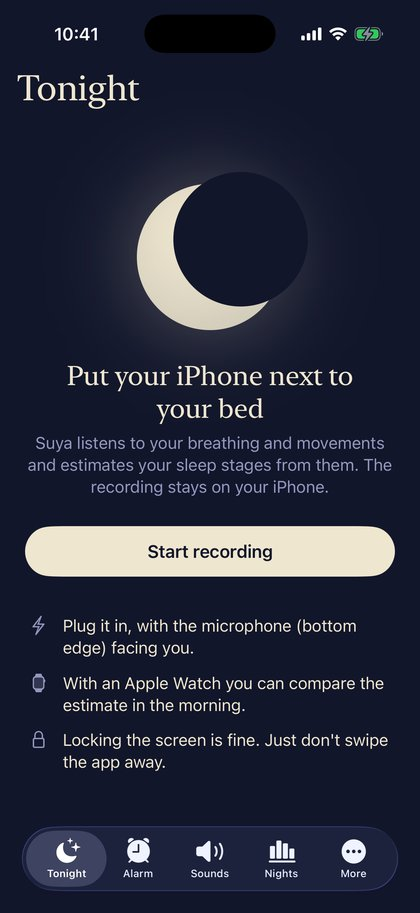
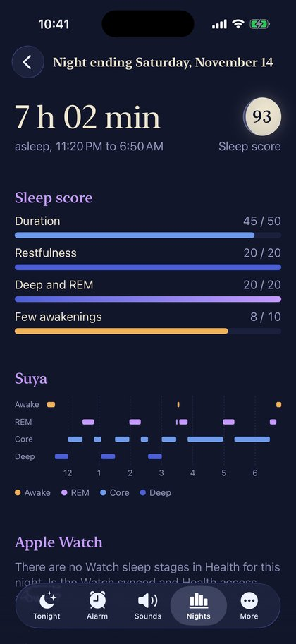
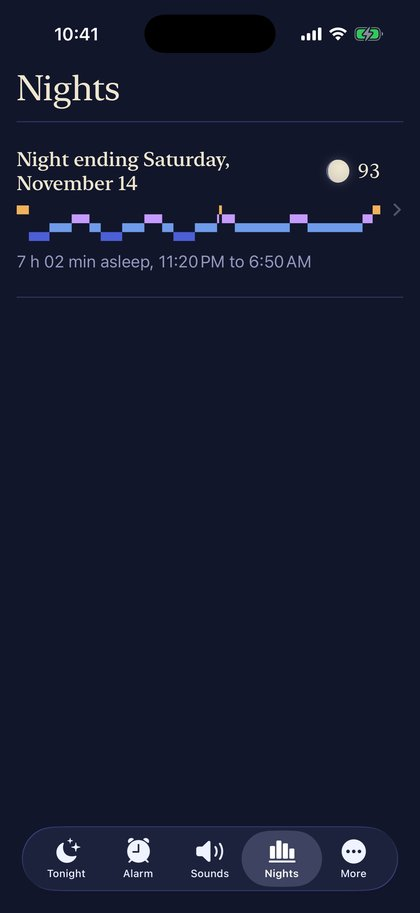
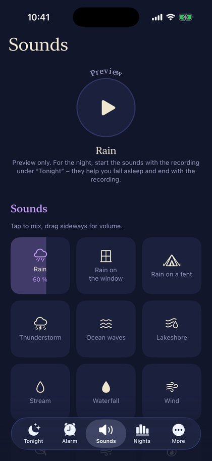
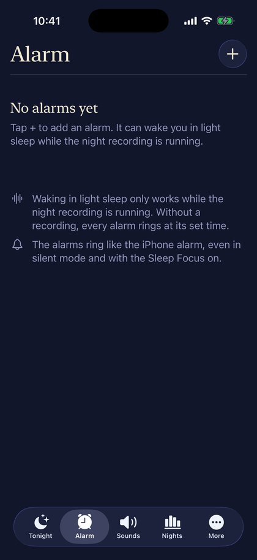
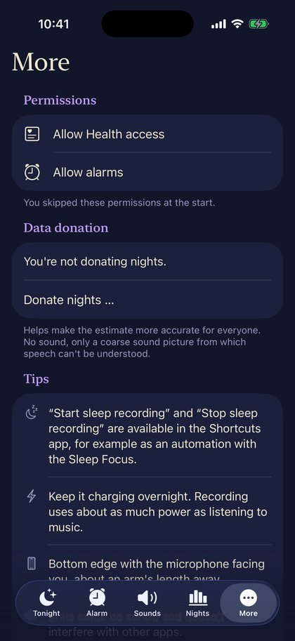

<p align="center">
  
</p>

<h1 align="center">Suya</h1>
<p align="center"><b>The iPhone sleep tracker that simply listens.</b><br>
Put your iPhone next to your bed – Suya recognises your sleep stages from breathing and movement.<br>
No watch, no wristband, no cloud.</p>

## What Suya does

<table>
<tr>
<td width="230"></td>
<td>
<h3>Just lie down</h3>
Plug in your iPhone, place it next to the bed and start recording. Suya only listens – no watch, no
wristband. Live Activity on the lock screen, Shortcuts (“Start sleep recording”) for your Sleep Focus
and a calm landscape view for the nightstand.
</td>
</tr>
<tr>
<td>
<h3>Sleep stages on your iPhone</h3>
A small neural network recognises <b>awake, REM, core and deep sleep</b> from breathing and movement –
right on the device, nothing goes to a cloud. Plus a sleep score from duration, restfulness, deep and REM
sleep and awakenings. Stages can be written to <b>Apple Health</b>; with an Apple Watch you see both
estimates side by side.
</td>
<td width="230"></td>
</tr>
<tr>
<td></td>
<td>
<h3>All your nights at a glance</h3>
Every night with its sleep score and a mini timeline. Long-press to delete, export or donate a night;
the audio stays available for export for 24 hours.
</td>
</tr>
<tr>
<td>
<h3>27 sleep sounds</h3>
Rain on the window, campfire, ocean waves, snowstorm, singing bowls and more – real recordings, freely
mixable, with a timer and a gentle fade-out as soon as you fall asleep. Time with sounds playing is left
out of the analysis.
</td>
<td></td>
</tr>
<tr>
<td></td>
<td>
<h3>Wake up in light sleep</h3>
Alarms by time or by sleep duration. While recording, Suya wakes you within your chosen window as soon
as you are in light sleep – and rings like the iPhone alarm, even in silent mode and Sleep Focus.
</td>
</tr>
<tr>
<td>
<h3>Privacy first</h3>
Everything is analysed on the iPhone and stays there (not in iCloud or computer backups). After 24 hours
the full audio is deleted. What remains: short clips of the detected sounds (snoring, talking, coughing –
these can contain speech) and, for 7 days, a coarse sound image from which speech cannot be understood.
You can delete clips or whole nights at any time.<br><br>
<b>Voluntary data donation:</b> if you like, you can donate single nights (sound image and sleep stages,
no recordings) to a private server in Hamburg, Germany, to make the model better – withdraw and delete
at any time in the app.<br><br>
<a href="https://suya.ng-lab.de/en/privacy">Privacy policy</a> ·
<a href="https://suya.ng-lab.de/en/imprint">Imprint</a><br><br>
Available in 10 languages: English, German, Spanish, French, Italian, Portuguese, Dutch, Japanese,
Korean and Chinese.
</td>
<td></td>
</tr>
</table>

## Install (SideStore)

SideStore → **Sources** → **+** → add this URL:

```
https://github.com/NikGro/suya/releases/latest/download/source.json
```

Then install Suya once from this source. New versions show up automatically under “My Apps”. To let
Suya access Apple Health with a free Apple ID, SideStore needs a small patch – see
[sidestore/README.md](sidestore/README.md).

Versions are named *year.month.number* (e.g. `26.11.14`); every push to `main` builds and publishes a new
version.

## Repository layout

| Folder | Contents |
|---|---|
| `Suya/` | the app (SwiftUI): recording, analysis, alarms, sounds, data donation |
| `Packages/SonarDSP/` | signal processing (log-mel spectrogram, normalisation) with tests |
| `Widgets/` | Live Activity and widgets |
| `training/` | training of the sleep stage model (PyTorch → Core ML) |
| `server/` | server for data donations, bug reports and the website (runs on a Synology NAS) |
| `scripts/` | translations, sounds, helper scripts |

**The model** learns from audio of sleep lab recordings (public dataset) and from own nights with
Apple Watch sleep stages. Architecture inspired by SoundSleepNet: log-mel spectrogram per 30-second epoch
→ small CNN → bidirectional GRU over the whole night.

## License

[PolyForm Noncommercial 1.0.0](LICENSE): viewing, trying, modifying and sharing are allowed for
noncommercial purposes; commercial use only with written permission.
The sleep sounds come from freesound.org (CC0 / CC BY) and remain under their own licenses – credits in
the app under “Sound credits”.
